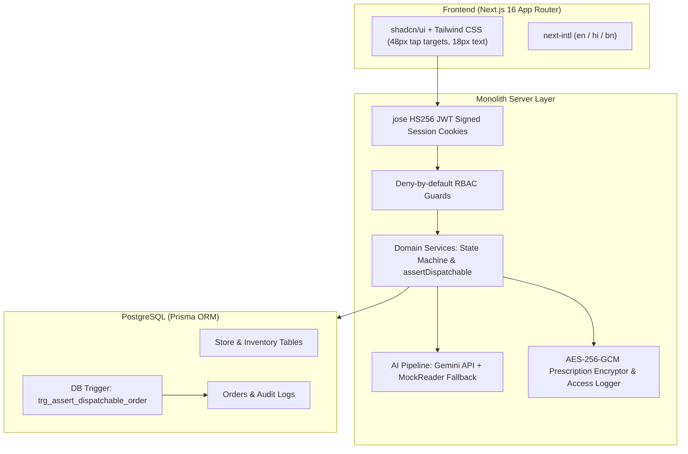

# MedKart Pharmacy — Online Reordering with Pharmacist Prescription Checks

A regulated healthcare commerce web application built for a pharmacy chain in Kolkata and Howrah (10 seeded demo stores across key Kolkata and Howrah clusters, representing the 46-store network with central warehouse operations).

[](https://github.com/P1Manav/MedKart/actions/workflows/ci.yml)
[](https://github.com/P1Manav/MedKart)
[](https://github.com/P1Manav/MedKart)

---

## 1. Key Value Proposition & Safety Mandates

1. **Deterministic Safety (Never AI-Decided):** AI transcribes prescriptions as an unapproved **draft only**. Every prescription must be individually verified and approved by a registered pharmacist before dispensing.
2. **Strict Statutory Gating (Drugs & Cosmetics Rules):**
   - **Schedule H & H1:** Must have a valid prescription and registered pharmacist sign-off snapshotting their registration number.
   - **Schedule H1:** Mandatory register entry recording prescriber name, registration number, patient name, date, and quantity.
   - **Schedule X & Narcotics:** **Zero online sales permitted.** Blocked both server-side and by database triggers.
3. **Defense in Depth:** Dual-layer enforcement via application service `assertDispatchable(order)` and PostgreSQL database triggers.
4. **DPDP Act 2023 Compliance:** Prescription images are encrypted at rest with AES-256-GCM (random 96-bit IV per file). Decrypted only on authorized routes with an append-only access log recording every view.
5. **Multi-Store Inventory Routing:** Computes Haversine distance from customer delivery address to all 46 stores, routing to the nearest store with 100% stock coverage, with automated fallback for stock deficits.
6. **Languages Supported:** English, Hindi (हिंदी), and Bengali (বাংলা) via `next-intl`.

---

## 2. Sample Seed Orders (Verbatim from Client Brief)

| Order ID | Customer | Item | Schedule | Qty | Price ₹ | Prescription | Store | Status |
|---|---|---|---|---|---|---|---|---|
| **RX-50211** | Debasish Ghosh (for mother) | Metformin 500 mg, strip of 15 | H | 4 | 120 | Approved | Salt Lake | **Packed** |
| **RX-50214** | Rina Sen | Telmisartan 40 mg, strip of 10 | H | 3 | 285 | Pending | Behala | **Awaiting pharmacist** |
| **RX-50219** | Arif Mondal | Levothyroxine 50 mcg, bottle of 100 | H | 1 | 190 | Re-upload asked | Howrah Maidan | **On hold** |

---

## 3. Quick Start & Local Setup

### Prerequisites
- Node.js 20+ or 22+
- Docker (optional, for local PostgreSQL via Docker Compose)

### 1. Clone & Install
```bash
git clone https://github.com/P1Manav/MedKart.git
cd MedKart
npm install
```

### 2. Environment Configuration
Copy `.env.example` to `.env`:
```bash
cp .env.example .env
```
Default `.env` settings work out of the box with `OTP_MOCK="true"` and local SQLite/PostgreSQL.

### 3. Generate Synthetic Prescriptions & Seed Database
```bash
# Generate 10 synthetic prescription images
python scripts/generate_prescriptions.py

# Generate Prisma Client & Run Seed
npx prisma generate
npm run seed
```

### 4. Run Test Suite
```bash
# Runs 158 unit & API integration tests across 26 test suites
npm test

# Run 8 real PostgreSQL trigger integration tests (against Neon or local Postgres)
npm run test:db

# Run strict TypeScript typecheck
npm run typecheck

# Run ESLint
npm run lint
```

### 5. Start Development Server
```bash
npm run dev
```
Open [http://localhost:3000](http://localhost:3000) in your browser.

---

## 4. 10-Minute Reviewer Walkthrough

The top ribbon on every page includes a **Demo Roles Switcher** for instant 1-click testing:

1. **Customer Flow:** Click `Customer (Debasish)` &rarr; tap `Reorder My Medicines` &rarr; select one of the synthetic prescriptions &rarr; submit order. Notice it generates a tracking timeline.
2. **Pharmacist Flow:** Click `Pharmacist (Sunita)` &rarr; open `Verification Queue` &rarr; click `Verify Prescription` on the submitted order.
   - Inspect the prescription with Zoom In/Out, Rotate, and Pan controls.
   - Review AI draft medicines with confidence indicators.
   - Approve lines or request re-upload (places order `ON_HOLD`).
   - Click `Approve Order & Route to Store`.
3. **Store Staff Flow:** Click `Store Staff (Salt Lake)` &rarr; see order in `Store Fulfillment Desk`.
   - Verify that unapproved orders have their `Pack` button disabled with a clear reason.
   - For approved orders, click `Pack Order`, enter invoice number (e.g. `INV-SL-2026-901`), and mark packed.
4. **Ops Dashboard:** Click `Ops Dashboard` &rarr; inspect multi-store volumes, median verification times, trigger automated refill reminders, and validate daily stock CSV imports.

---

## 5. Architecture & Tech Stack



---

## 6. Security & Health Data Privacy (DPDP Act 2023)

- **Prescription Encryption:** Prescriptions are encrypted at rest with AES-256-GCM using a 32-byte secret key and a unique random 12-byte IV per image.
- **Tamper Detection:** Authenticated GCM tags ensure any tampering throws an unrecoverable decryption error.
- **Append-Only Access Log:** Every decryption or view of a prescription writes an append-only row to `prescription_access_log` recording `userId`, `userRole`, `orderId`, `action: VIEW`, `timestamp`, and SHA-256 hashed IP address.
- **Zero Raw File Exposure:** Prescriptions are served exclusively via authorized stream routes (`/api/prescription/[id]/image`). Raw file system paths are never exposed.

---

## 7. Assumptions

See [`docs/ASSUMPTIONS.md`](docs/ASSUMPTIONS.md) for domain assumptions documented per specification.
For production deployment instructions to Vercel and Neon, see [`docs/deployment.md`](docs/deployment.md).
