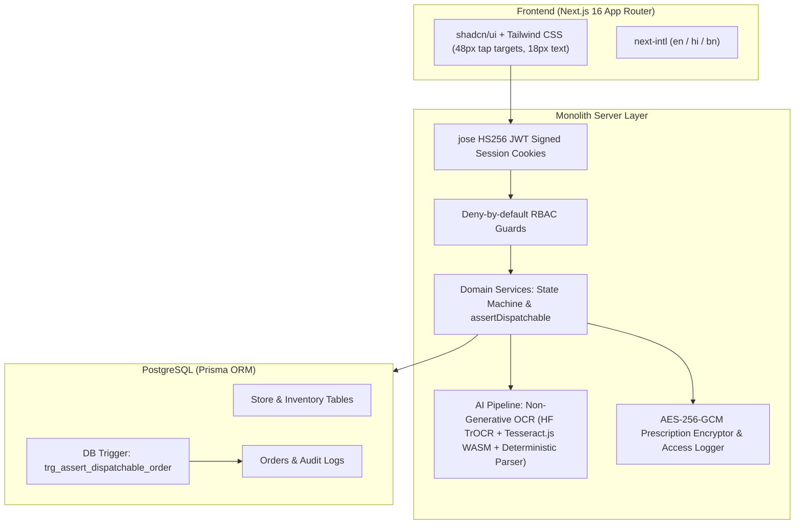

# MedKart Pharmacy — Online Reordering with Pharmacist Prescription Checks

A regulated healthcare commerce web application built for a pharmacy chain in Kolkata and Howrah (10 seeded demo stores across key Kolkata and Howrah clusters, representing the 46-store network with central warehouse operations).

[](https://github.com/P1Manav/isocode_assignment/actions/workflows/ci.yml)
[](https://github.com/P1Manav/isocode_assignment)
[](https://github.com/P1Manav/isocode_assignment)

---

## 1. Key Value Proposition & Safety Mandates

1. **Deterministic Safety (Never AI-Decided):** AI transcribes prescriptions as an unapproved **draft only**. Every prescription must be individually verified and approved by a registered pharmacist before dispensing.
2. **Strict Statutory Gating (Drugs & Cosmetics Rules):**
   - **Schedule H & H1:** Must have a valid prescription and registered pharmacist sign-off snapshotting their registration number.
   - **Schedule H1:** Mandatory register entry recording prescriber name, registration number, patient name, date, and quantity.
   - **Schedule X & Narcotics:** **Zero online sales permitted.** Blocked both server-side and by database triggers.
3. **Defense in Depth:** Dual-layer enforcement via application service `assertDispatchable(order)` and PostgreSQL database triggers.
4. **DPDP Act 2023 Compliance:** Prescription images are encrypted at rest with AES-256-GCM (random 96-bit IV per file). Decrypted only on authorized routes with an append-only access log recording every view.
5. **Multi-Store Inventory Routing:** Computes Haversine distance from customer delivery address to all 46 stores, routing to the nearest store with 100% stock coverage, with automated fallback for stock deficits.
6. **Languages Supported:** English, Hindi (हिंदी), and Bengali (বাংলা) via `next-intl`.

---

## 2. Sample Seed Orders (Verbatim from Client Brief)

| Order ID | Customer | Item | Schedule | Qty | Price ₹ | Prescription | Store | Status |
|---|---|---|---|---|---|---|---|---|
| **RX-50211** | Debasish Ghosh (for mother) | Metformin 500 mg, strip of 15 | H | 4 | 120 | Approved | Salt Lake | **Packed** |
| **RX-50214** | Rina Sen | Telmisartan 40 mg, strip of 10 | H | 3 | 285 | Pending | Behala | **Awaiting pharmacist** |
| **RX-50219** | Arif Mondal | Levothyroxine 50 mcg, bottle of 100 | H | 1 | 190 | Re-upload asked | Howrah Maidan | **On hold** |

---

## 3. Quick Start & Local Setup

### Prerequisites
- Node.js 20+ or 22+
- Docker (optional, for local PostgreSQL via Docker Compose)

### 1. Clone & Install
```bash
git clone https://github.com/P1Manav/isocode_assignment.git
cd isocode_assignment
npm install
```

### 2. Environment Configuration
Copy `.env.example` to `.env`:
```bash
cp .env.example .env
```
Default `.env.example` settings work out of the box with `DEMO_MODE="true"` and PostgreSQL (Supabase or local Docker Compose).

| Variable Name | Required in Prod | Group | Description |
|---|---|---|---|
| `DATABASE_URL` | **Yes** | Core | PostgreSQL connection string |
| `SHADOW_DATABASE_URL` | CI / Dev | Core | Shadow PostgreSQL database for `prisma migrate dev` & CI schema drift checks |
| `NEXT_PUBLIC_APP_URL` | No | Core | Canonical public URL of the application |
| `CRON_SECRET` | **Yes** | Core | Shared secret bearer token securing automated refill cron |
| `PUBLIC_CATALOGUE_OTC_ONLY` | No | Core | Restricts unauthenticated /api/products to OTC items only |
| `SESSION_SECRET` | **Yes** | Session/Crypto | 32+ char secret for HS256 JWT cookie signing |
| `PRESCRIPTION_ENC_KEY` | **Yes** | Session/Crypto | 64-char hex key (32 bytes) for AES-256-GCM prescription encryption |
| `OTP_PEPPER` | **Yes** | Session/Crypto | 16+ char secret pepper for HMAC-SHA256 OTP hashing and audit logs |
| `SMS_PROVIDER` | No | OTP/SMS | Selected provider (`msg91`, `twilio_verify`, `fast2sms`, or `mock`) |
| `MSG91_AUTH_KEY` | No | OTP/SMS | MSG91 API auth key for SMS dispatch |
| `MSG91_TEMPLATE_ID` | No | OTP/SMS | MSG91 DLT approved flow template ID |
| `SMS_PROVIDER_TEMPLATE_ID` | No | OTP/SMS | Generic SMS provider template ID fallback |
| `TWILIO_ACCOUNT_SID` | No | OTP/SMS | Twilio Account SID |
| `TWILIO_AUTH_TOKEN` | No | OTP/SMS | Twilio Auth Token |
| `TWILIO_VERIFY_SERVICE_SID` | No | OTP/SMS | Twilio Verify Service SID or Messaging Service SID |
| `TWILIO_PHONE_NUMBER` | No | OTP/SMS | Twilio sender phone number in E.164 format (+1...) |
| `FAST2SMS_API_KEY` | No | OTP/SMS | Fast2SMS API Key |
| `EMAIL_PROVIDER` | No | Email | Email provider (`resend`, `brevo`, or `smtp`) |
| `RESEND_API_KEY` | No | Email | Resend API key for email OTP fallback |
| `BREVO_API_KEY` | No | Email | Brevo API key for transactional email delivery |
| `SMTP_HOST` | No | Email | SMTP host address for transactional email |
| `EMAIL_FROM` | No | Email | Sender email address for OTP delivery |
| `DEMO_MODE` | No | Demo | Enables top role switcher & mock OTP for demo numbers |
| `DEMO_PHONES` | No | Demo | Comma-separated allowlist of 10-digit demo numbers |
| `AI_READER` | No | AI/OCR | Reader selection: `hf`, `tesseract`, or `mock` |
| `HF_API_TOKEN` | No | AI/OCR | Hugging Face free-tier token for Tier 1 TrOCR |
| `HF_OCR_MODEL` | No | AI/OCR | OCR model identifier (default: `microsoft/trocr-base-handwritten`) |
| `PAYMENT_GATEWAY_KEY_ID` | No | Payments | Razorpay / Cashfree sandbox test key ID |
| `PAYMENT_GATEWAY_KEY_SECRET` | No | Payments | Payment gateway sandbox key secret |
| `PAYMENT_GATEWAY_WEBHOOK_SECRET` | No | Payments | Webhook HMAC verification secret |
| `UPI_PAYEE_VPA` | No | UPI | Direct UPI payee VPA (Path B). Option hidden if omitted. |
| `UPI_PAYEE_NAME` | No | UPI | Direct UPI payee business name |
| `UPI_MAX_AMOUNT_INR` | No | UPI | Maximum order amount in INR permitted for direct UPI (default: 100) |

### 3. Generate Synthetic Prescriptions & Seed Database
```bash
# Generate 10 synthetic prescription images
python scripts/generate_prescriptions.py

# Generate Prisma Client & Run Seed
npx prisma generate
npm run seed
```

### 4. Run Test Suite
```bash
# Runs 238 unit & API integration tests across 35 test suites
npm test

# Run 8 real PostgreSQL trigger integration tests (against Supabase or local Postgres)
npm run test:db

# Run strict TypeScript typecheck
npm run typecheck

# Run ESLint
npm run lint

# Run Playwright E2E tests
npx playwright test
```

### 5. Start Development Server
```bash
npm run dev
```
Open [http://localhost:3000](http://localhost:3000) in your browser.

---

## 4. 10-Minute Reviewer Walkthrough

The top ribbon on every page includes a **Demo Roles Switcher** for instant 1-click testing:

1. **Customer Flow (or Self-Registration):**
   - Click `Customer (Debasish)` from the top ribbon (or register a new account on `/login` via the "New to MedKart? Create an account" self-registration link).
   - Tap `Reorder My Medicines` &rarr; select one of the synthetic prescriptions &rarr; choose delivery address.
   - Select payment method: either **Sandbox UPI Gateway (Path A)** with instant simulation, or **Direct UPI Transfer (Path B)** with genuine QR code, voluntary demo consent, and 12-digit UTR submission.
   - Submit order. Notice it generates a live tracking timeline.
2. **Pharmacist Flow:** Click `Pharmacist (Sunita)` &rarr; open `Verification Queue` &rarr; click `Verify Prescription` on the submitted order.
   - Inspect the AES-256 decrypted prescription image with Zoom In/Out, Rotate, and Pan controls.
   - Review AI draft medicines with confidence indicators (Tier 1 TrOCR / Tier 2 Tesseract WASM).
   - Approve lines or request re-upload (places order `ON_HOLD`).
   - Click `Approve Order & Route to Store`.
3. **Store Staff Fulfillment Desk:** Click `Store Staff (Salt Lake)` &rarr; view orders assigned to Salt Lake store.
   - **Direct UPI Gate Enforcement:** If the order was placed via Direct UPI, the order requires explicit payment confirmation. Click `Confirm UPI Receipt` to verify the 12-digit UTR into the audit trail. Attempting to pack prior to confirmation is strictly blocked server-side (HTTP 400).
   - **Pack & Invoice:** Click `Pack Order`, enter invoice number (e.g. `INV-SL-2026-901`), and mark packed. The application-layer `assertDispatchable` check and PostgreSQL trigger guarantee no unapproved orders can ever be packed.
   - **Courier Handover & Delivery:** Mark `Handover to Courier` (recording courier partner & tracking ID) and transition to `Delivered`.
4. **Ops Dashboard:** Click `Ops Dashboard` &rarr; inspect multi-store volume heatmaps, median pharmacist verification times, SLA tracking, trigger automated refill reminders, and validate daily stock CSV imports.

---

## 5. Architecture & Tech Stack



---

## 6. Security & Health Data Privacy (DPDP Act 2023)

- **Prescription Encryption:** Prescriptions are encrypted at rest with AES-256-GCM using a 32-byte secret key and a unique random 12-byte IV per image.
- **Tamper Detection:** Authenticated GCM tags ensure any tampering throws an unrecoverable decryption error.
- **Append-Only Access Log:** Every decryption or view of a prescription writes an append-only row to `prescription_access_log` recording `userId`, `userRole`, `orderId`, `action: VIEW`, `timestamp`, and SHA-256 hashed IP address.
- **Zero Raw File Exposure:** Prescriptions are served exclusively via authorized stream routes (`/api/prescription/[id]/image`). Raw file system paths are never exposed.

---

## 7. Assumptions

See [`docs/ASSUMPTIONS.md`](docs/ASSUMPTIONS.md) for domain assumptions documented per specification.
For production deployment instructions to Vercel and Supabase, see [`docs/deployment.md`](docs/deployment.md).
