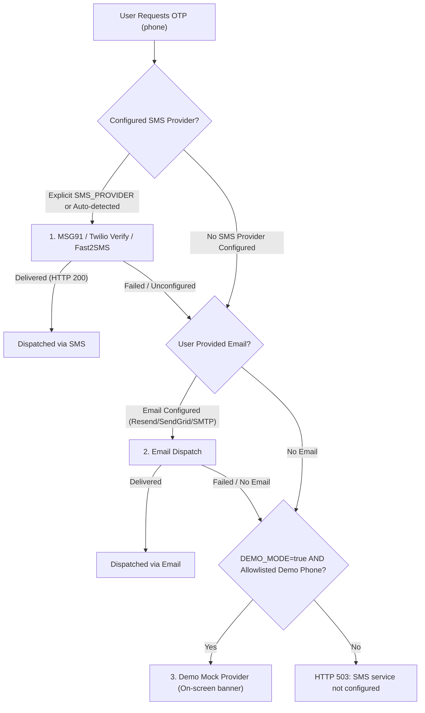
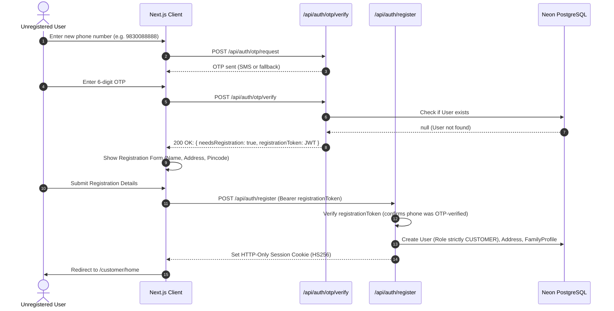

# Production-Grade OTP Authentication & Delivery Architecture

This document describes the design, security controls, rate limiting, provider fallback chain, and self-service registration workflow powering MedKart's OTP authentication system.

---

## 1. Security Architecture & Threat Model

MedKart replaces fragile, unauthenticated SMS shortcuts with an enterprise-grade phone verification and authentication pipeline designed against brute-force, timing attacks, user enumeration, and SMS toll fraud.

### Core Cryptographic Controls
- **HMAC-SHA256 Salted Hashing:** OTPs are never stored in plaintext in the database. Each OTP is hashed with HMAC-SHA256 using an application-wide secret pepper (`OTP_PEPPER`) and a cryptographically random 16-byte hex salt per record:
  $$\text{otpHash} = \text{HMAC-SHA256}(\text{OTP\_PEPPER}, \text{salt} \parallel \text{otp})$$
- **Timing-Safe Verification:** Submitted codes are hashed with the stored salt and compared using `crypto.timingSafeEqual` over fixed-length binary buffers to eliminate side-channel timing leaks.
- **Fail-Closed Production Pepper:** In production (`NODE_ENV === 'production'`), if `OTP_PEPPER` is omitted or shorter than 16 characters, the application halts at startup with a fatal configuration error.
- **Atomic Invalidation & Concurrency Guard:** When an OTP is requested, existing unconsumed records for that phone number are immediately invalidated. Verification uses atomic SQL updates (`attempts: { lt: 5 }, used: false`) to prevent race conditions.

---

## 2. Rate Limiting, Cooldowns & Lockout Rules

To protect users against brute-force guessing and protect infrastructure from SMS toll fraud, multi-layered rate limits are strictly enforced:

| Rule | Threshold | Scope | Action when Exceeded |
|---|---|---|---|
| **Request Cooldown** | 30 seconds | Per phone number | Rejects with HTTP 429: "Please wait 30 seconds before requesting another code" |
| **Short-Window Rate Limit** | 3 requests / 15 minutes | Per phone number | Rejects with HTTP 429: "Too many OTP requests. Please wait a few minutes" |
| **IP-Based Anti-Abuse** | 5 requests / 15 minutes | Per client IP address | Rejects with HTTP 429: Prevents distributed enumeration and spam across different numbers |
| **Long-Window Rate Limit** | 10 requests / 1 hour | Per phone number | Rejects with HTTP 429: Caps total requests per phone per hour |
| **Max Verification Attempts** | 5 attempts | Per OTP record | Increments attempt count atomically; once 5 attempts are reached, OTP is permanently invalidated |
| **Account Lockout** | 5 failed attempts in 1 hour | Per phone number | Rejects subsequent requests with HTTP 429: "Account locked for 1 hour due to repeated failed attempts" |
| **OTP Expiry** | 5 minutes | Per OTP record | Codes older than 5 minutes fail verification and are marked `used: true` |

> **Production Integrity Rule:** Production code does not branch on `CI=true` or `NODE_ENV=test` to relax limits. Rate limits are dependency-injected via `OtpLimitsConfig` with strict production defaults.

---

## 3. Provider Fallback Priority Chain

MedKart implements a resilient multi-provider dispatch chain (`OtpProviderChain` in `src/lib/auth/otp-providers/chain.ts`):

### Provider Details:
1. **Msg91 (`Msg91Provider`):** Primary enterprise SMS provider in India. Uses MSG91 Send OTP v5 API (`authkey`, `template_id`).
2. **Twilio Verify (`TwilioVerifyProvider`):** Global fallback via Twilio Verify API v2 (`TWILIO_ACCOUNT_SID`, `TWILIO_AUTH_TOKEN`, `TWILIO_VERIFY_SERVICE_SID`).
3. **Fast2SMS (`Fast2SmsProvider`):** Cost-effective Indian SMS gateway (`FAST2SMS_API_KEY`).
4. **Email OTP (`EmailOtpProvider`):** Automatic secondary channel when SMS delivery fails or is throttled (`RESEND_API_KEY` or `SMTP_*`).
5. **Mock Provider (`MockOtpProvider`):** Selected via `SMS_PROVIDER="mock"` or engaged **strictly** when `DEMO_MODE=true` and the recipient number belongs to the allowlisted demo pool (`DEMO_PHONES` or default seeded accounts):
   - `9830011111` (Customer: Debasish Ghosh)
   - `9830022222` (Customer: Rina Sen)
   - `9830033333` (Customer: Arif Mondal)
   - `9830044444` (Pharmacist: Sunita Banerjee)
   - `9830066661` (Store Staff: Bikash Mondal)
   - `9830099999` (Ops Admin: Arijit Sen)

> **No Leaks Policy:** Real phone numbers outside this allowlist are **never** shown an on-screen OTP code even in demo mode; real SMS via `SMS_PROVIDER` (or email fallback) is required. If no real provider is configured, non-demo requests return HTTP 503 honestly.

---

## 4. Self-Service Registration Workflow

To allow arbitrary customers and reviewers to log in with their own phone numbers while preventing unauthorized role escalation:

### Security Properties:
- **Signed Registration Token:** Short-lived JWT (15-minute expiry) signed with `SESSION_SECRET` containing `{ phone, type: 'registration' }`.
- **Role Constrained:** The registration endpoint strictly enforces `role: 'CUSTOMER'`. Pharmacist, store-staff, and ops roles are admin-seeded only and cannot be self-registered.
- **Initial Profile Setup:** Automatically provisions the primary delivery address and creates a default "Self" family profile so immediate reordering is frictionless.

---

## 5. Audit Logging & Compliance (DPDP Act 2023)

Every OTP dispatch and verification event is recorded in the `otp_deliveries` and `otp_records` audit tables:
- **Phone Privacy:** Phone numbers in audit logs are salted and hashed (`hashPhoneForLog`), while UI displays are masked (`+91 98****1111`).
- **IP Address Tracking:** Requesting IP addresses are recorded to monitor distributed attacks and comply with statutory audit standards.
