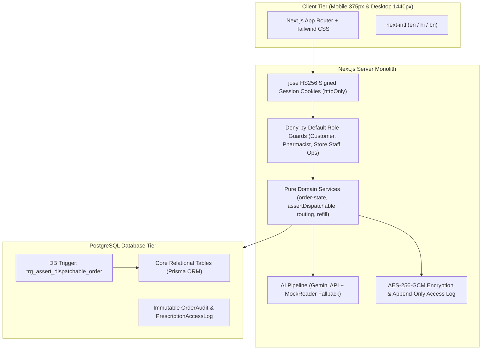
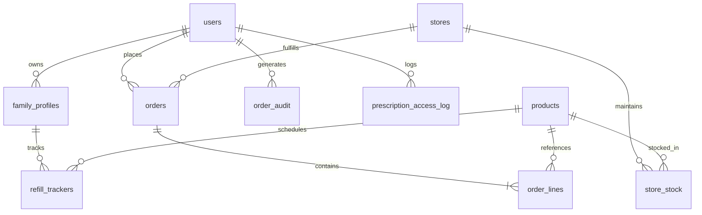
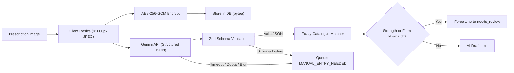

# Technical Design Document (TDD)
# MedKart Pharmacy — Online Reordering with Pharmacist Prescription Checks

**Repository URL:** [https://github.com/P1Manav/isocode_assignment](https://github.com/P1Manav/isocode_assignment)  
**Author:** Manav Prajapati (maxprajapati606@gmail.com)  
**Date:** November 2026  
**Status:** Complete & Verified (v1.0.0)

---

## 1. Executive Summary & Problem Scope

MedKart operates a network of 46 pharmacy retail stores and a central distribution warehouse across Kolkata and Howrah. The mandate of this platform is to enable chronic patients and family caregivers to reorder essential monthly prescription medications in approximately one minute on mobile devices, with same-day delivery from the nearest store possessing verified stock.

In healthcare commerce, correctness and regulatory compliance take absolute precedence over generative cleverness. Under India's **Drugs and Cosmetics Rules** and the **Digital Personal Data Protection (DPDP) Act 2023**:
1. No Schedule H or H1 drug may ever be dispensed without a valid prescription verified by a registered pharmacist.
2. Schedule X and Narcotic substances are strictly prohibited from being sold or ordered online.
3. Every Schedule H1 transaction requires a physical/digital statutory register entry capturing prescriber and patient details.
4. Prescriptions represent sensitive personal health data requiring authenticated encryption at rest and an immutable audit log for every view.

The AI component functions strictly as a transcription draft assistant. **The system never allows AI to make clinical, dispensing, or dispatch decisions.**

---

## 2. Architecture & Stack Rationale

### 2.1 Locked Monolithic Architecture



### 2.2 Why These Choices?

| Technology | Selection Reason & Trade-Off Analysis |
|---|---|
| **Next.js 16 (App Router)** | Monolithic simplicity without microservice sprawl. Server components prevent sensitive business logic from leaking to the browser. Built-in route handlers handle multipart encryption. |
| **PostgreSQL + Prisma ORM** | ACID transactions are essential for multi-store inventory reservation and order state transitions. Committed migrations guarantee reproducible deployment on Neon. |
| **PostgreSQL Trigger (`trg_assert_dispatchable_order`)** | Defense in depth: Guarantees that even if an application bug or malicious raw SQL attempted to update an order to `PACKED`, the database engine itself aborts the transaction if pharmacist approval or prescription is missing. |
| **AES-256-GCM Encryption** | NIST-standard authenticated symmetric encryption. A unique random 96-bit IV per file prevents rainbow-table attacks, while 128-bit authentication tags immediately detect ciphertext tampering. |
| **Gemini API (Structured Outputs)** | Free-tier multimodal model receiving instructions to transcribe only what is legible without hallucinating missing text. Validated via Zod schemas. |
| **Fuse.js Matcher** | In-process fuzzy search comparing brand names and strengths without requiring heavy external Elasticsearch clusters. |

---

## 3. Data Model & Entity Relationships

The data model is strictly normalized across 12 relational tables:



### 3.1 Primary Entities
- `users`: Phone-based authentication, RBAC roles (`CUSTOMER`, `PHARMACIST`, `STORE_STAFF`, `OPS`), and pharmacist registration numbers.
- `family_profiles`: Supports caregivers ordering for aging parents (e.g. Debasish Ghosh ordering for his mother, Anjali Ghosh).
- `stores`: 10 seeded stores across Kolkata & Howrah (Salt Lake, Behala, Howrah Maidan, Gariahat, etc.) with geographic coordinates.
- `products`: ~40 products categorised into `OTC`, `H`, `H1`, `X`, and `NARCOTIC`.
- `schedule_rules`: Configurable database-driven rules governing online sales, prescription requirements, pharmacist approvals, and register entries.
- `orders`: Tracks lifecycle from `DRAFT` to `DELIVERED`, storing encrypted prescription bytea, IV, auth tag, and AI metadata.
- `order_lines`: Line-level status (`PENDING`, `APPROVED`, `EDITED_APPROVED`, `REJECTED`, `BLOCKED_NOT_SOLD_ONLINE`), AI confidence, generic substitution consent, and H1 register fields.

---

## 4. Domain Logic & Dual-Layer Safety Gating

### 4.1 Order State Machine (`src/domain/order-state.ts`)

Transitions strictly follow a deterministic state machine:
- `DRAFT` &rarr; `SUBMITTED` &rarr; (`APPROVED` | `ON_HOLD` | `REJECTED`) &rarr; `PACKED` &rarr; `HANDED_OVER` &rarr; `DELIVERED`
- `ON_HOLD` is utilized when a prescription is blurry or missing critical details; it transitions back to `SUBMITTED` upon customer re-upload.
- Any illegal transition (e.g. `SUBMITTED` &rarr; `PACKED` bypassing approval) immediately throws `IllegalTransitionError` and writes to the audit log.

### 4.2 Application Defense: `assertDispatchable(order)`

The single entry-point service function `assertDispatchable` must pass before any transition into `PACKED`, `HANDED_OVER`, or `DELIVERED`:
1. Prescription image must be attached and uncorrupted.
2. Prescription date must be within the validity window (default 6 months, configurable).
3. Every active line must have status `APPROVED` or `EDITED_APPROVED` signed with a registered pharmacist's license number.
4. Schedule H1 items must possess complete prescriber details (name, medical council registration number), patient name, date, and dispensed quantity.

### 4.3 Database Defense: PostgreSQL Dispatch Trigger

As a secondary layer of defense, `trg_assert_dispatchable_order` executes `BEFORE UPDATE OF status ON orders`. If raw SQL attempts to bypass the application layer to pack an unapproved Schedule H order, the trigger raises a PL/pgSQL exception:
```sql
RAISE EXCEPTION 'Dispatch blocked by DB trigger: line(s) lack valid pharmacist approval';
```

---

## 5. AI Transcription Pipeline & Uncertainty Handling

### 5.1 Pipeline Flow



### 5.2 Honest AI: Handling Mistakes & Uncertainty
- **Illegible or Blurry Images:** When legibility is flagged as `unreadable` or the model confidence falls below threshold, the order automatically enters the pharmacist queue flagged as `MANUAL_ENTRY_NEEDED`. The customer is never shown an error stack or blocked.
- **Strength Mismatch Protection:** Even if a drug name matches 100% (e.g. *Metformin*), if the prescription reads *1000 mg* while the catalogue item is *500 mg*, the line score is penalized and **strictly forced to `needs_review`**.
- **Schedule X Auto-Flagging:** If an item matching Schedule X (e.g. *Methylphenidate*) or Narcotics is detected, it is auto-flagged `BLOCKED_NOT_SOLD_ONLINE` and disabled from cart/dispatch.
- **Generic Substitution:** Linked via `generic_substitutes`. Displays price differential only (e.g. save ₹115 on Rosuvastatin) without medical claims; requires **both** pharmacist approval and recorded patient consent.

---

## 6. Multi-Store Routing & Refill Automation

### 6.1 Haversine Inventory Routing (`src/domain/routing.ts`)
- Pincode coordinates map customer locations to latitude and longitude.
- Stores are sorted by Haversine great-circle distance.
- The system evaluates real inventory coverage:
  - If nearest store has 100% stock, it is assigned.
  - If a stock deficit exists (e.g., Behala store out of Telmisartan 40 mg), the order is rerouted to the nearest store possessing full inventory, or flags missing lines with the next-nearest alternative store.

### 6.2 Refill Calculation & Idempotent Reminders (`src/domain/refill.ts`)
- Computed via: $\text{days\_of\_supply} = \lfloor \text{units\_dispensed} / \text{units\_per\_day} \rfloor$.
- $\text{run\_out\_date} = \text{dispense\_date} + \text{days\_of\_supply}$.
- Reminder fires when $\text{run\_out\_date} - \text{today} \le 5\text{ days}$.
- **Idempotency:** Once sent for a cycle, `reminder_sent = true` suppresses duplicate SMS/WhatsApp messages.

---

## 7. UI/UX Decisions & Accessibility

1. **Minimal, Calm Design System:** Neutral off-white canvas (`#fafaf9`), single deep teal primary (`#0f766e`), muted caution amber (`#b45309`), and muted restriction red (`#b91c1c`). Zero flashing promos, zero banners, zero carousels.
2. **Typography & Tap Targets:** 18px base text size and minimum 48px tap targets across all interactive buttons, optimized for elderly patients and mobile phone screens.
3. **Responsive Pharmacist Review Workspace:**
   - **Desktop (1440px):** Two-column side-by-side layout. Left pane features the encrypted prescription image with Zoom In/Out, Rotate 90°, and Pan controls. Right pane displays matched items with AI confidence badges, raw text comparison, and one-click approvals.
   - **Mobile (375px):** Sticky tab switcher toggling seamlessly between "Prescription Document" and "Matched Items".
4. **Multilingual Inclusivity:** Full English, Hindi, and Bengali localization with Noto Sans font families.

---

## 8. Labeled Assumptions (per Brief §2)

| # | What Was Assumed | Why It Was Assumed | Code Location |
|---|---|---|---|
| **A1** | Prescription validity defaults to 6 months from prescription date | Indian pharmacy convention for chronic repeat prescriptions | `src/domain/assert-dispatchable.ts` |
| **A2** | Invented `generic_substitutes` table links brands to bioequivalent generics | Client brief §5.5 specifies generic options as an assumption | `prisma/schema.prisma` |
| **A3** | Pincode-to-lat/lng seeded lookup table for Kolkata (~20 pincodes) | Avoids flaky external geocoding API dependencies | `prisma/schema.prisma`, `seed.ts` |
| **A4** | Hindi and Bengali UI strings are AI-drafted | Required disclosure; pending fluent speaker review | `messages/hi.json`, `messages/bn.json` |
| **A5** | All prescription images in seed data are synthetic | Compliance with public AI service terms and patient privacy | `seed/prescriptions/`, `scripts/` |
| **A6** | Prescription upload limit is 5 MB; JPEG and PNG only | Standard mobile camera resolution; prevents DoS memory spikes | `src/lib/validators/upload.ts` |
| **A7** | OTP rate limit: max 5 requests per 15 min; max 5 verification attempts | Industry-standard brute-force protection | `src/lib/auth/otp.ts` |
| **A8** | Haversine distance used for Kolkata routing | City-scale store proximity without third-party road routing | `src/domain/routing.ts` |
| **A9** | Stock CSV format: `store_id, product_id, quantity` | Pragmatic format for daily inventory synchronization | `src/lib/validators/stock-csv.ts` |
| **A10** | Refill reminder trigger defaults to 5 days before run-out | Provides patient adequate lead time for reorder and delivery | `src/domain/refill.ts` |
| **A11** | Pharmacist registration numbers in seed data are synthetic | Spec strictly forbids real medical registration numbers | `prisma/seed.ts` |
| **A12** | Session cookies utilize HS256 signed JWTs | Stateless, fast verification in monolith server actions | `src/lib/auth/session.ts` |
| **A13** | Customer addresses are pre-seeded with 1-click selection | Streamlines 1-minute mobile reorder flow | `prisma/seed.ts` |
| **A14** | Family profiles include "Myself", "Mother", and "Father" | Standard family medicine management paradigm | `prisma/seed.ts` |
| **A15** | Mock payment modes (UPI / COD) succeed after simulated delay | Brief specifies payment integrations are mocked | `src/app/customer/order/new/` |
| **A16** | Platform brand name "MedKart" is synthetic | Neutral pharmacy naming per domain requirements | Throughout UI |
| **A17** | Schedule H1 register date (`h1Date`) records verified prescription issue date | Drugs & Cosmetics Rules require date of prescription on register | `src/app/api/pharmacist/orders/[id]/verify/route.ts` |

---

## 9. Scope Cut & Future Roadmap

### 9.1 What Was Deliberately Cut (Scope Discipline)
1. **Real Payment Gateways:** Real UPI/Razorpay integrations were omitted per brief §2 ("Payments, OTP, SMS and WhatsApp are MOCKED").
2. **Third-Party Geocoding:** External Google Maps APIs were replaced with seeded Kolkata pincode centroids to eliminate external latency and billing points.
3. **Doctor Consultations & Lab Bookings:** Explicitly ruled out-of-scope in the brief to focus 100% of effort on the core prescription reordering and pharmacist verification lifecycle.

### 9.2 What Would Be Done Next (Production Hardening)
1. **OCR Offline Fallback:** Embed an on-device Tesseract.js / lightweight ONNX vision model for client-side text pre-filtering before cloud submission.
2. **ERP / POS Connector:** Webhook and HL7/FHIR connectors to synchronize inventory directly with physical retail store billing POS machines.
3. **Automated WhatsApp Business Integration:** Replace mocked outbox rows with official Meta WhatsApp Cloud API for automated refill notifications.
4. **Hardware Barcode Scanner Support:** In the Store Packing screen, integrate USB/Bluetooth handheld barcode scanner input to verify GTIN/batch barcodes during pick-and-pack.
